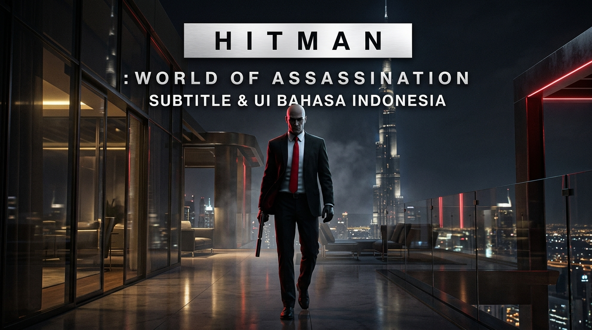
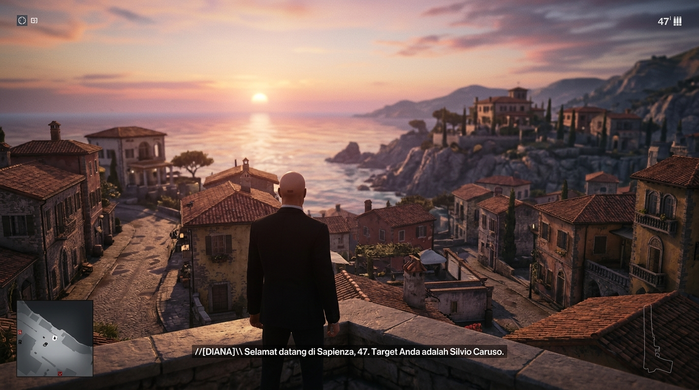

# 🕵️‍♂️ HITMAN: World of Assassination — Mod Subtitle & UI Bahasa Indonesia

[-blue.svg)]()

Mod lokalisasi lengkap untuk **HITMAN: World of Assassination (HITMAN 3)** di PC yang menerjemahkan dialog cerita, briefing Diana Burnwood, cutscene sinematik, percakapan NPC & target misi, serta antarmuka/menu utama ke dalam **Bahasa Indonesia**.

Kompatibel 100% dengan instalasi standar **Steam**, **Epic Games**, maupun instalasi mod via **Simple Mod Framework (SMF)**.

---

## 📸 Tampilan / Preview In-Game

---

## ✨ Fitur & Cakupan Mod

* **1.379+ File Dialog Cerita & Subtitel (DLGE):**
  * Seluruh briefing misi dari Diana Burnwood.
  * **Prologue & ICA Facility Training** (Tutorial dasar & ujian eliminasi Jasper Knight).
  * **Hitman 3 Misi Utama 1: Dubai ("On Top of the World")** — Seluruh dialog target Carl Ingram & Marcus Stuyvesant, percakapan staf, pengumuman interkom menara Sceptre, dan briefing misi.
  * Percakapan *in-game* antar NPC, target misi, intel rahasia, dan percakapan penjaga.
  * Sinkronisasi timing audio dan teks tetap presisi 100% menggunakan timestamp bawaan engine Glacier.
* **Antarmuka & Menu Utama (LOCR):**
  * Navigasi Menu Utama (*Play, Destinations, Career, Options*).
  * HUD, status penyamaran (*Disguise Suspicious, In Crime Scene*), skor eliminasi (*Headshot, Moving Kill, Target Hidden*).
* **Mendukung 2 Metode Pemasangan:**
  * **Simple Mod Framework (SMF):** Langsung otomatis terpasang & ter-deploy.
  * **Non-SMF / Manual Patch:** Menggunakan RPKG patch asli tanpa perlu aplikasi tambahan.

---

## ⚠️ PERHATIAN PENTING (BACA INI!)

> [!IMPORTANT]
> **Hitman mematikan subtitle secara default (bawaan game)!**
> Setelah memasang mod, kamu **WAJIB mengaktifkan subtitle** di menu game:
> 
> **Options ➔ Audio / Gameplay ➔ Subtitles: ON**
> 
> Jika opsi ini belum di-ON-kan, game tidak akan menampilkan subtitle dialog apapun!

---

## 🚀 Cara Pemasangan

### Opsi A: 1-Click Otomatis dengan Installer (Paling Mudah)
1. Unduh repositori ini (Klik tombol hijau **Code** ➔ **Download ZIP** lalu ekstrak).
2. Buka folder hasil ekstrak, lalu klik kanan **`Install_Sub_Indo.bat`** ➔ **Run as administrator** (atau klik dua kali biasa).
3. Installer akan otomatis mendeteksi:
   * Jika kamu memakai **Simple Mod Framework (SMF)**: Mod otomatis disalin ke folder SMF dan langsung di-deploy.
   * Jika kamu **tidak** memakai SMF: Mod langsung dipasang ke folder `Runtime` game dan membuat backup otomatis.
4. Muncul pesan sukses **PEMASANGAN MOD SELESAI & BERHASIL!**.

---

### Opsi B: Pemasangan Manual via Simple Mod Framework (SMF)
Bagi pengguna setia SMF:
1. Buka folder repositori ini, masuk ke folder **`SMF_Mod\HITMAN 3 Sub Indo`**.
2. Copy folder **`HITMAN 3 Sub Indo`** tersebut ke dalam folder mod SMF kamu:
   * `HITMAN 3\Simple Mod Framework\Mods\`
3. Buka **Simple Mod Framework** (Mod Manager), pastikan mod **HITMAN 3 Sub Indo** dicentang / aktif di load order.
4. Klik **Apply / Deploy**. Selesai!

---

### Opsi C: Pemasangan Manual Tanpa SMF (Pure Native)
Jika tidak menggunakan mod framework:
1. Buka folder instalasi game kamu, lalu masuk ke folder **`Runtime`**:
   * *Steam:* `C:\Program Files (x86)\Steam\steamapps\common\HITMAN 3\Runtime`
   * *Epic:* `C:\Program Files\Epic Games\HITMAN3\Runtime`
2. Di dalam folder `Runtime`, buat salinan cadangan file `packagedefinition.txt` menjadi `packagedefinition.txt.bak`.
3. Buka folder **`mod_files`** dari repositori ini, lalu copy seluruh file di dalamnya:
   * `chunk0patch5.rpkg`
   * `chunk14patch5.rpkg`
   * `packagedefinition.txt`
4. Paste dan **Replace / Timpa** ke dalam folder **`Runtime`** game kamu. Selesai!

---

## 🔄 Cara Menghapus Mod (Uninstall)

Jika ingin mengembalikan game ke Bahasa Inggris asli developer kapan saja:
* Cukup klik dua kali file **`Uninstall_Sub_Indo.bat`**, atau:
* Hapus file `chunk0patch5.rpkg` dan `chunk14patch5.rpkg` di folder `Runtime`, lalu kembalikan nama file cadangan `packagedefinition.txt.bak` menjadi `packagedefinition.txt`.

---

## 🛠️ Kredit & Perangkat
* Dibuat menggunakan **[RPKG-Tool](https://github.com/glacier-modding/RPKG-Tool)** dan **HMLanguageTools** oleh komunitas modding IO Interactive / Glacier Engine.
* Dikembangkan oleh **SatyaGanzz** untuk komunitas gamer PC Indonesia.
